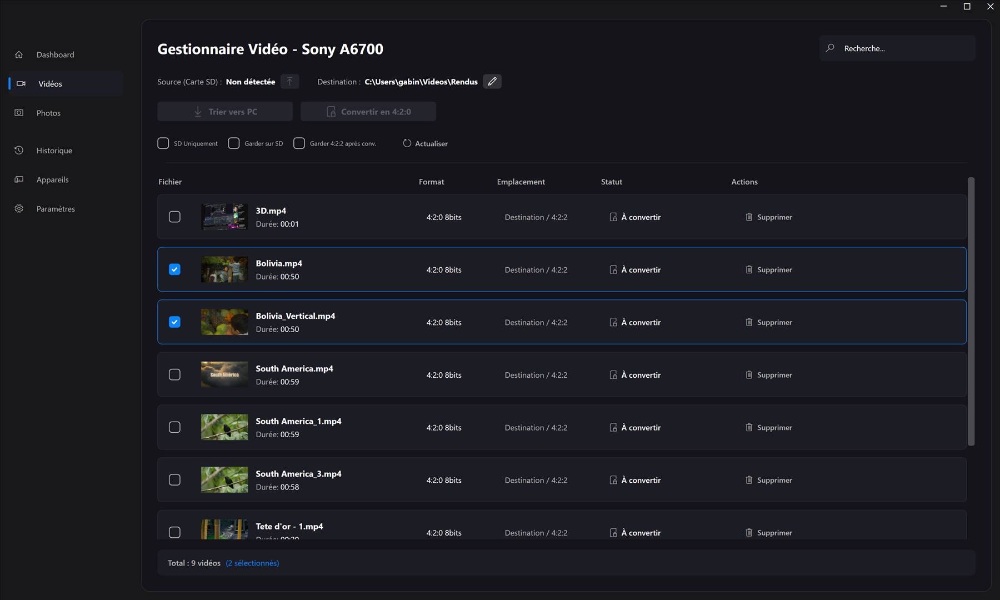
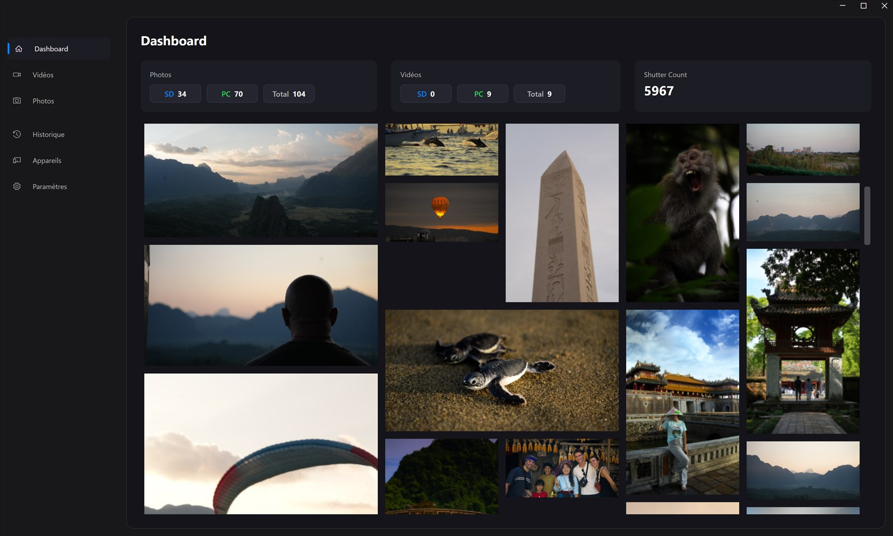

# VideoManager — post-production tool for Sony A6700 footage

**VideoManager** is a Windows desktop app (C# / .NET 10 / WPF) that automates my video workflow with a
Sony A6700: offloading the SD card, converting heavy 4:2:2 10-bit footage into files that edit smoothly,
and browsing the videos and photos in one place.

> **Built with an AI coding agent.** I designed the tool, specified each feature, steered the agent and
> tested the app on my own footage; the C# code was written by **Google Antigravity (Gemini)**.
> [`GEMINI.md`](GEMINI.md) is the project memory I maintain for the agent: architecture choices,
> UI rules and coding guidelines it must follow.





## Why

The A6700 records 4:2:2 10-bit video, which is heavy to play back while editing.
Copying the card, sorting the files, converting the clips and checking the photos were separate manual steps;
VideoManager puts them in one window.

## Features

- **SD card detection and offload**: finds the Sony clip folder (`PRIVATE\M4ROOT\CLIP`) automatically and
  copies files to the PC, sorted by type, together with their Sony `.XML` metadata sidecars.
- **4:2:2 10-bit → 4:2:0 8-bit conversion** with HandBrakeCLI and a custom preset
  ([`Conversion420.json`](Conversion420.json)); FFprobe reads each clip's pixel format and duration.
- **Built-in player** based on LibVLCSharp, for native Sony files, with a fullscreen view
  (play/pause, seek bar, volume).
- **Photo library** for RAW (`.ARW`) and JPEG files; video and photo lists show each file's format.
- **Overwrite prompts** when a file already exists at the destination: overwrite, skip, or apply to all.
- **Dashboard** with high-resolution thumbnails in a masonry layout, and the camera's **shutter count** read with ExifTool.
- **Safe operations**: asynchronous SD card ejection with a progress bar, deleted files go to the Recycle Bin.
- **Custom dark UI**: `WindowChrome` title bar, dark immersive window frame through `dwmapi.dll`,
  in-app overlays instead of system dialogs; all disk and process work runs off the UI thread.

## Tech stack

C#, .NET 10, WPF · LibVLCSharp · MetadataExtractor · external tools: FFmpeg / FFprobe, HandBrakeCLI, ExifTool.

## Build and run

Requires Windows and the .NET 10 SDK.

1. Download the external tools and put them next to `VideoManager.csproj` (they are not in the repository):
   - `ffmpeg.exe` and `ffprobe.exe` — <https://ffmpeg.org/download.html>
   - `HandBrakeCLI.exe` — <https://handbrake.fr/downloads2.php>
   - `exiftool.exe` **and its `exiftool_files/` folder** (Windows package) — <https://exiftool.org/>
2. Build and run:

```bash
dotnet run
```

The build copies the tools to the output folder.

## Status

Personal tool, used on my own footage. Next steps are tracked in [`TODO.md`](TODO.md) (in French).

## License

No license: all rights reserved. The code is public for reference.
